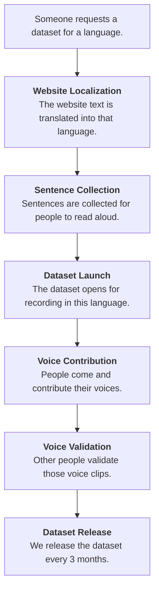

## Why Common Voice? {#why-common-voice}

Common Voice is a publicly available voice dataset, powered by the voices of volunteer contributors around the world. People who want to build voice applications can use the dataset to train machine learning models.

At present, most voice datasets are owned by companies, which stifles innovation. Voice datasets also underrepresent: non-English speakers, people of colour, disabled people, women and LGBTQIA+ people. This means that voice-enabled technology doesn’t work at all for many languages, and where it does work, it may not perform equally well for everyone. We want to change that by mobilising people everywhere to share their voice.

## How does Common Voice work? {#how-it-works}

We’re crowdsourcing an open-source dataset of voices. Donate your voice, validate the accuracy of other people’s clips, make the dataset better for everyone.

**Speak**: Contributors record voice clips by reading from a bank of donated sentences.

**Listen**: Users validate the accuracy of donated clips, checking that the speaker read the sentence correctly.

**Is the clip valid?** A Yes vote means one person found the clip correct. A clip counts as validated when it has at least two votes and more people said Yes than No.

**≥ 2 votes**: A clip needs votes from at least two separate users to be validated. Clips that are not validated are released too, in separate parts of the dataset.

## How are project decisions made? {#governance}

Mozilla Common Voice is made possible by a diverse community of activists, linguists, data scientists, academics and software engineers from all over the world. The project is stewarded by the Mozilla Foundation.

Our governance is founded on the pillars of:

- Privacy, security and transparency.
- Community participation and decision making.
- Value and recognition.
- Mutual accountability.

## How is Common Voice funded? {#funding}

Common Voice is a project of the Mozilla Foundation, a US 501c3. The project is currently funded entirely by [philanthropic grants](https://foundation.mozilla.org/blog/mozilla-common-voice-dataset-grows-by-30-and-reaches-87-languages/), and donations from people around the world.

It costs a lot of money to continually host and release the datasets, improve the platform and run [community programmes](https://foundation.mozilla.org/common-voice/in-country-programmes).

If you or your organisation would like to contribute back to the project, reach out to our partnerships team on [commonvoice@mozilla.com](mailto:commonvoice@mozilla.com).

## How do I stay in touch? {#stay-in-touch}

You can meet others in the Mozilla language communities by joining [Discord](https://discord.gg/common-voice) or [Discourse](https://discourse.mozilla.org/c/voice/239) for topical conversations, or [Matrix](https://chat.mozilla.org/#/room/#common-voice:mozilla.org) for quick advice.

- [Partnerships](partnerships.md)
- [Community and Languages](../community/index.md)
